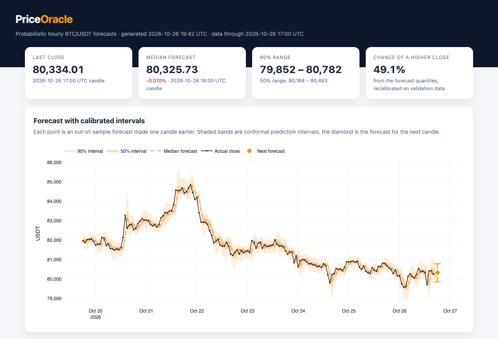
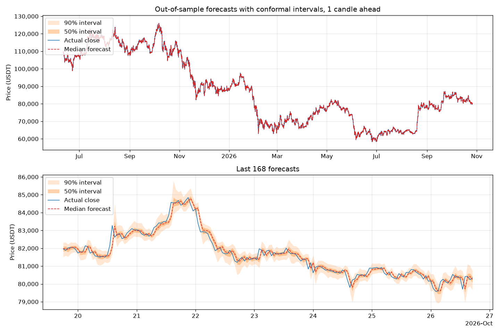
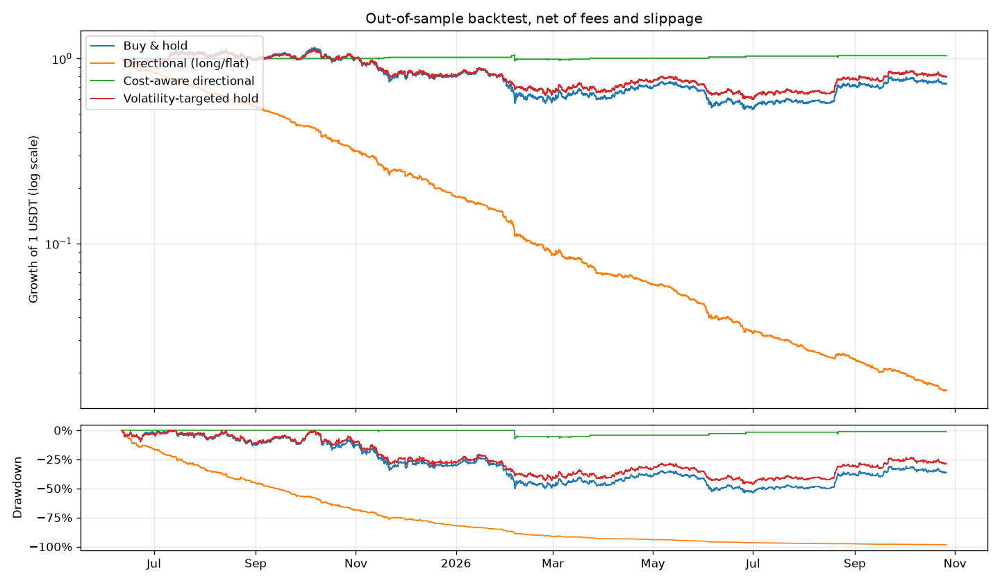

# PriceOracle

Probabilistic hourly Bitcoin (BTC/USDT) forecasting in PyTorch. Quantile neural networks with conformal calibration, compared honestly against classic baselines, stress-tested by a cost-aware backtester, and published as a self-updating interactive dashboard.

> **Disclaimer:** This is a research and learning project, not financial advice. Do not trade with real money based on its output.



## Why PriceOracle is different

Most price-prediction demos show a near-perfect fit that comes from data leakage, or from a model that simply repeats the last price. PriceOracle is built to measure what can actually be predicted:

- **Distributions, not just points.** The network predicts five quantiles of the next return, which give a median forecast, 50% and 90% prediction intervals, and a probability of a rise.
- **Calibrated uncertainty.** Conformalized quantile regression adjusts the intervals so that a 90% interval contains the outcome about 90% of the time on data the model has never seen. The rolling variant adapts as volatility regimes change.
- **Honest baselines.** Every number is reported next to a naive last-close forecast and the classic risk models used in practice: EWMA (RiskMetrics-style) volatility and historical simulation.
- **Reality check with costs.** A backtester turns forecasts into trading rules and charges exchange fees and slippage on every trade.
- **Leakage-free by construction.** Causal features, chronological splits, training-only scalers, and calibration that only uses outcomes already known at forecast time.
- **Live.** A GitHub Actions workflow refreshes the data, retrains the model and republishes the dashboard once a month.

## Results

All results come from the default model, a 2-layer GRU with a 48-hour input window and a 1-hour horizon. The test period runs from June 11, 2025 to October 26, 2026: 12,057 hourly forecasts that were never used for training, early stopping or calibration fitting.

### Risk forecasts beat the classic baselines

| Method | 90% coverage | 90% width | 90% interval score | 50% coverage | 50% interval score |
| --- | ---: | ---: | ---: | ---: | ---: |
| **GRU + rolling conformal** | **90.04%** | 1.231% | **1.851** | **50.51%** | **0.938** |
| GRU + static conformal | 91.13% | 1.280% | 1.849 | 51.58% | 0.938 |
| GRU, raw quantiles | 89.21% | 1.174% | 1.849 | 45.63% | 0.940 |
| EWMA volatility | 91.21% | 1.342% | 1.981 | 62.80% | 0.972 |
| Historical simulation | 89.66% | 1.251% | 2.055 | 50.19% | 0.962 |

Width is the average interval width as a share of the price. The interval score (lower is better) is a proper scoring rule that rewards narrow intervals but heavily penalizes misses.

- The rolling-conformal intervals hit their nominal coverage almost exactly (90.04% and 50.51%), while remaining sharper than EWMA.
- On the 90% interval score, the model is **9.9% better than historical simulation and 6.6% better than EWMA**. Its pinball loss (9.39 bps) also beats both (9.68 and 9.71 bps).
- The neural network has learned volatility clustering: the bands widen right after large moves (see the chart below).



### The direction is close to a coin flip

| Point forecast | MAE (USDT) | RMSE (USDT) | Directional accuracy | Brier score of P(up) |
| --- | ---: | ---: | ---: | ---: |
| GRU median | 243.64 | 373.77 | 52.19% | 0.2492 |
| Naive (last close) / coin flip | 243.07 | 371.09 | 50.00% (always up) | 0.2500 |

Hourly returns are close to a random walk. The median forecast is about as accurate as repeating the last close, and the directional edge is small. The probability of a rise is recalibrated on the validation period and only marginally beats a constant 50% guess.

### Backtest: fees destroy directional trading

| Strategy | Return | Sharpe | Max drawdown | Exposure | Trades | Fees paid |
| --- | ---: | ---: | ---: | ---: | ---: | ---: |
| Buy & hold | −26.8% | −0.35 | −53.7% | 100% | 1 | 0.1% |
| Directional (long/flat) | −98.4% | −9.75 | −98.4% | 51% | 3,451 | 98.6% |
| Cost-aware directional | +3.7% | 0.46 | −7.4% | 1% | 36 | 4.3% |
| Volatility-targeted hold | −19.9% | −0.30 | −46.4% | 100% | 131 | 2.6% |

Costs: 0.10% exchange fee plus 0.02% slippage per trade. "Fees paid" is the total as a share of the starting capital.

- Trading every hour on the predicted direction pays almost the entire starting capital in fees. A 52% hit rate is worthless at this horizon.
- The cost-aware rule only enters when the expected move exceeds the round-trip cost. It traded just 36 times, which is far too few to call it an edge.
- Volatility targeting uses the risk forecast rather than the direction: it scales exposure down when forecast volatility is high. In this falling market it cut the maximum drawdown by 7 percentage points. This is the most realistic use of the forecasts.



### Model zoo leaderboard

Every architecture was trained with the same data, splits, seed and early stopping, then scored on the same test period. Pinball loss and the interval score are lower-is-better. Intervals use rolling conformal calibration.

| Model | Parameters | Pinball (bps) | 90% coverage | 90% width | Interval score | MAE skill vs naive | Direction | Brier |
| --- | ---: | ---: | ---: | ---: | ---: | ---: | ---: | ---: |
| GRU | 39,493 | 9.394 | 90.0% | 1.231% | 1.851 | -0.23% | 52.19% | 0.2492 |
| LSTM | 52,549 | 9.402 | 90.0% | 1.230% | 1.855 | -0.46% | 52.09% | 0.2494 |
| TCN | 88,965 | 9.411 | 90.1% | 1.230% | 1.846 | -0.72% | 51.99% | 0.2494 |
| Transformer | 166,533 | 9.430 | 90.3% | 1.255% | 1.863 | -0.56% | 52.29% | 0.2493 |
| Linear | 45 | 9.582 | 90.0% | 1.222% | 1.904 | -0.99% | 51.83% | 0.2497 |
| EWMA volatility | – | 9.679 | 91.2% | 1.342% | 1.981 | – | – | – |
| Historical simulation | – | 9.707 | 89.7% | 1.251% | 2.055 | – | – | – |

The lowest pinball loss comes from the **GRU** (9.394 bps, 90.0% coverage of the 90% interval). The best classic baseline, EWMA volatility, scores 9.679 bps.

## Live dashboard

`python scripts/report.py` writes `reports/index.html`, a single interactive page built with Plotly. It shows:

- the next-hour forecast with its 50% and 90% ranges;
- a fan chart of the last week of out-of-sample forecasts;
- calibration over time, compared with the baselines;
- point and direction metrics;
- the backtest with equity and drawdown curves;
- permutation feature importance.

The **Live forecast** workflow (`.github/workflows/forecast.yml`) runs on the first day of every month. It refreshes the data, retrains the model and republishes the dashboard on GitHub Pages, and you can also start it at any time from the **Actions** tab. To publish from your own copy, open **Settings → Pages** and set **Source** to **GitHub Actions**. Until then, scheduled runs skip the build, and manual runs upload the dashboard as a downloadable artifact.

## Quick start

Requires Python 3.11 or newer. Clone the repository, then:

```bash
cd PriceOracle
python -m venv .venv
source .venv/bin/activate        # Windows: .venv\Scripts\activate
pip install -r requirements.txt
```

To get the smaller CPU-only PyTorch build, run `pip install torch --index-url https://download.pytorch.org/whl/cpu` before installing the requirements.

The repository includes hourly BTC/USDT candles in `data/btc_usdt.csv`. One command refreshes them, trains the model and builds the dashboard:

```bash
python scripts/pipeline.py       # then open reports/index.html
```

Or run the steps one by one:

```bash
python scripts/fetch_data.py     # append the latest closed candles
python scripts/train.py          # train with early stopping, save models/bitcoin_price_predictor.pt
python scripts/evaluate.py       # test metrics vs. the baselines
python scripts/backtest.py       # trading rules, net of costs
python scripts/predict.py        # forecast the next hourly close
python scripts/report.py         # build the interactive dashboard
python scripts/benchmark.py      # train and rank every architecture
```

Training takes a few minutes on a laptop CPU. CUDA is used automatically when available; on Apple Silicon, add `--device mps`.

Example forecast:

```text
Latest candle: 2026-10-26 17:00 UTC, close 80,334.01 USDT
Forecast for the 2026-10-26 18:00 UTC candle close:
  Median:     80,325.73 USDT (-0.010%)
  50% range:  80,183.62 - 80,462.53 USDT
  90% range:  79,852.41 - 80,782.48 USDT
  Chance of a higher close: 49.1%
```

## Command reference

| Script | Purpose | Useful options |
| --- | --- | --- |
| `scripts/pipeline.py` | Fetch, train (or reuse) and build the dashboard plus `metrics.json` | `--skip-fetch`, `--reuse-model`, `--output-dir`, `--offline` |
| `scripts/fetch_data.py` | Create or update a candle CSV from Binance | `--symbol ETHUSDT`, `--interval 4h`, `--start 2020-01-01`, `--output`, `--full-refresh` |
| `scripts/train.py` | Train a model and save a checkpoint | `--model-type transformer`, `--epochs`, `--data-path`, `--model-path`, `--config`, `--device` |
| `scripts/evaluate.py` | Point, direction and interval metrics vs. the baselines | `--split val`, `--plot chart.png`, `--metrics-out metrics.json` |
| `scripts/backtest.py` | Simulate the trading rules, net of costs | `--fee 0.001`, `--slippage 0.0002`, `--plot equity.png`, `--metrics-out` |
| `scripts/predict.py` | Forecast the next close with prediction intervals | `--history-out forecasts.csv` (every out-of-sample forecast, tagged by split) |
| `scripts/report.py` | Build the interactive HTML dashboard | `--output`, `--offline` (embed plotly.js), `--no-importance` |
| `scripts/benchmark.py` | Train every architecture and write a leaderboard | `--models gru tcn`, `--epochs`, `--output-dir` |

Run any script with `--help` for all options. Paths given on the command line are relative to your current directory. Paths in the config file are relative to the project root.

## How it works

### Data and features

The dataset holds hourly spot candles for BTC/USDT from Binance, starting in August 2017. `fetch_data.py` uses the public market-data API, so no key is needed. It downloads only candles that have closed, re-downloads the last stored candle in case it was saved before closing, and leaves existing rows byte-identical.

Every feature is scale-free and causal: it only uses candles up to the current one.

| Feature | Description |
| --- | --- |
| `log_return` | Log return of the candle |
| `hl_range` | Log of high / low (intrabar volatility) |
| `close_sma_ratio` | Distance of the close from its 20-period SMA |
| `close_ema_ratio` | Distance of the close from its 20-period EMA |
| `rsi` | 14-period RSI, scaled to 0–1 |
| `macd` | MACD (12/26) divided by the close |
| `volume_ratio` | Log volume relative to its 24-period average |
| `volatility` | 24-period standard deviation of log returns |

Indicator warm-up rows are dropped rather than back-filled with future values. Features are standardized with training-period statistics and clipped at ±5 standard deviations.

### Models

Every architecture maps a window of `seq_length` candles to quantiles of the log return over the next `horizon` candles. The defaults are 5%, 25%, 50%, 75% and 95%.

| `model_type` | Architecture |
| --- | --- |
| `gru` | Stacked GRU |
| `lstm` | Stacked LSTM |
| `transformer` | Pre-norm Transformer encoder with learned positional embeddings |
| `tcn` | Temporal convolutional network: dilated causal convolutions with residual blocks |
| `linear` | Linear model on the latest candle's features (sanity baseline) |

A monotone output head (a cumulative sum of softplus steps) makes it impossible for quantiles to cross. Training minimizes the pinball loss with AdamW, gradient clipping, a learning-rate reduction on plateaus, and early stopping on validation loss. The data is split chronologically 70/15/15; when `horizon > 1`, samples whose targets would overlap the next split are purged.

### Calibration

Raw quantiles are rarely perfectly calibrated, especially when volatility regimes shift. PriceOracle applies conformalized quantile regression with width-normalized scores, which measure how far outcomes fall outside an interval relative to its width:

- **Static:** the correction is fitted once on the validation period (split conformal).
- **Rolling (default):** the correction comes from the last `conformal_window` forecasts whose outcomes are already known. It adapts to regime changes and never looks ahead.

The probability of a rise is read from the predictive distribution, then shrunk toward 50% by a factor fitted on the validation period, because quantile-implied probabilities are overconfident when the directional signal is weak.

### Baselines and backtests

- **Historical simulation** uses empirical quantiles of the last `conformal_window` returns.
- **EWMA** uses a zero-mean Gaussian with exponentially weighted volatility (24-hour half-life).
- **Backtests** set positions at each close from that hour's forecast, hold them for one candle, and pay `fee_rate + slippage` on every change in position. The volatility-targeting rule compares the smoothed volatility forecast with its trailing 30-day median and rebalances at most once a day.
- **Feature importance** is measured by permutation: the increase in pinball loss when one feature is shuffled on the validation period.

## Configuration

All settings live in `scripts/config.json`:

| Key | Default | Description |
| --- | --- | --- |
| `data_path` | `data/btc_usdt.csv` | Candle CSV used for training |
| `model_path` | `models/bitcoin_price_predictor.pt` | Where the checkpoint is saved |
| `model_type` | `gru` | `gru`, `lstm`, `transformer`, `tcn` or `linear` |
| `horizon` | `1` | Number of candles ahead to forecast |
| `quantiles` | `[0.05, 0.25, 0.5, 0.75, 0.95]` | Predicted quantiles; must include 0.5. Symmetric pairs form the intervals |
| `seq_length` | `48` | Input window length in candles |
| `hidden_size` | `64` | Hidden units, channels or embedding size |
| `num_layers` | `2` | Recurrent layers, encoder layers or TCN blocks |
| `dropout` | `0.2` | Dropout |
| `learning_rate` | `0.001` | AdamW learning rate |
| `weight_decay` | `0.0001` | AdamW weight decay |
| `batch_size` | `256` | Mini-batch size |
| `num_epochs` | `50` | Maximum number of epochs |
| `patience` | `8` | Epochs without validation improvement before stopping |
| `val_ratio`, `test_ratio` | `0.15`, `0.15` | Sizes of the chronological validation and test blocks |
| `seed` | `42` | Random seed |
| `conformal_window` | `720` | Candles in the rolling calibration and historical-simulation windows (30 days) |
| `fee_rate`, `slippage` | `0.001`, `0.0002` | Backtest costs per unit traded |

## Project structure

```text
PriceOracle/
├── analysis/
│   ├── forecasts.py        # the forecast table every view is built from
│   ├── conformal.py        # static and rolling conformal calibration
│   ├── baselines.py        # historical simulation and EWMA risk models
│   ├── evaluation.py       # point, direction and interval scoring
│   ├── backtest.py         # cost-aware trading simulation and strategies
│   └── importance.py       # permutation feature importance
├── data/
│   ├── btc_usdt.csv        # hourly BTC/USDT candles from Binance
│   ├── preprocess.py       # loading, causal features, targets
│   ├── dataset.py          # sliding windows, chronological split, scaling
│   └── transforms.py       # checkpoint-friendly StandardScaler
├── models/
│   ├── gru_model.py, lstm_model.py, transformer_model.py, tcn_model.py, linear_model.py
│   ├── layers.py           # monotone quantile head and pinball loss
│   └── predictor.py        # self-contained checkpoints and inference
├── scripts/                # command-line tools (see the command reference)
├── utils/                  # config, seeding, devices, logging, metrics
├── tests/                  # pytest suite (synthetic data, no network)
└── docs/                   # figures used in this README
```

## Development

```bash
pip install -r requirements-dev.txt
pytest                  # synthetic data, no network, finishes in seconds
ruff check .
ruff format --check .
```

CI runs the linters and the test suite on Python 3.11, 3.12 and 3.13 for every push to `main` and every pull request.

## License

Released under the GNU General Public License v3.0. See [LICENSE](LICENSE).
