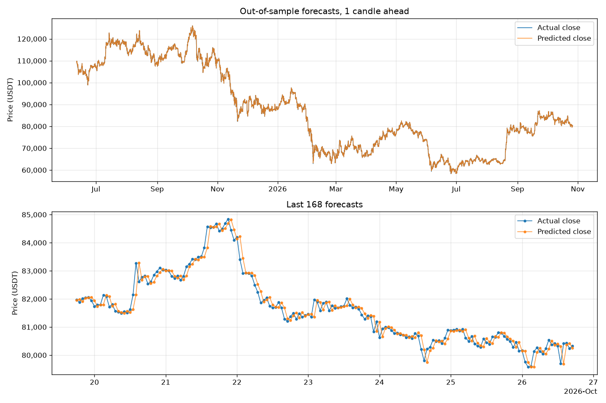

# PriceOracle

Hourly Bitcoin (BTC/USDT) price forecasting with GRU and LSTM networks in PyTorch, built around a leakage-free pipeline and an honest comparison with naive baselines.

> **Disclaimer:** This is a research and learning project, not financial advice. Do not trade with real money based on its output.



## Features

- **Leakage-free pipeline:** causal technical indicators, a strictly chronological train/validation/test split, and scalers fitted on the training period only.
- **Stationary target:** the network predicts the log return of the next candle, which is converted back into a USDT price. Raw prices drift far outside the range seen in training; returns do not.
- **Honest evaluation:** MAE, RMSE, MAPE and directional accuracy on unseen data, always reported next to a naive "last close" forecast and an "always up" guess.
- **Self-contained checkpoints:** weights, config, feature list, fitted scalers and split boundaries are saved together, so evaluation and forecasting each take a single command.
- **Incremental data updates** from Binance's public market-data API. No API key needed.
- **Configurable:** GRU or LSTM, window length, forecast horizon and training settings in one JSON file.
- **Tested:** a fast pytest suite on synthetic data (no network access) plus GitHub Actions CI.

## Results

Results for the default configuration: a 2-layer GRU with a 48-hour input window, forecasting one hour ahead. Data is split chronologically:

| Split | Period | Hourly samples |
| --- | --- | ---: |
| Train | Aug 2017 – Jan 2024 | 56,267 |
| Validation | Jan 2024 – Jun 2025 | 12,057 |
| Test | Jun 2025 – Oct 2026 | 12,057 |

The test period is never used for training, early stopping or model selection.

| Forecast | MAE (USDT) | RMSE (USDT) | MAPE | Directional accuracy |
| --- | ---: | ---: | ---: | ---: |
| GRU (this project) | 242.66 | 371.41 | 0.283% | **51.96%** |
| Naive: last close | 243.07 | 371.09 | 0.284% | – |
| Always up | – | – | – | 50.00% |

How to read these numbers:

- **Price error is on par with the naive forecast.** Hourly crypto returns are close to a random walk, so "the next close equals the last close" is very hard to beat. This also explains why the chart looks like an almost perfect fit, and why the forecast seems to lag the actual price by one candle: it stays close to the last known close.
- **The direction is slightly better than chance.** The model calls the direction of the next hour correctly 51.96% of the time across 12,057 unseen hours, about 4.3 standard errors above a coin flip. The edge is real but tiny: about 0.004% gross per hourly bet, far below typical exchange fees of around 0.1% per trade.

Numbers shift slightly as new candles extend the test period, and between hardware platforms.

## Quick start

Requires Python 3.11 or newer. Clone the repository, then:

```bash
cd PriceOracle
python -m venv .venv
source .venv/bin/activate        # Windows: .venv\Scripts\activate
pip install -r requirements.txt
```

To get the smaller CPU-only PyTorch build, run `pip install torch --index-url https://download.pytorch.org/whl/cpu` before installing the requirements.

The repository already includes hourly BTC/USDT candles in `data/btc_usdt.csv`, so you can train right away:

```bash
python scripts/fetch_data.py     # optional: append the latest closed candles
python scripts/train.py          # train with early stopping, save models/bitcoin_price_predictor.pt
python scripts/evaluate.py --plot reports/test_predictions.png   # test metrics vs. baselines
python scripts/predict.py        # forecast the next hourly close
```

Training takes a few minutes on a laptop CPU. CUDA is used automatically when available; on Apple Silicon, add `--device mps`.

Example forecast:

```text
Latest candle: 2026-10-26 17:00 UTC, close 80,334.01 USDT
Forecast for the 2026-10-26 18:00 UTC candle: close 80,344.07 USDT (+0.013%)
```

## Command reference

| Script | Purpose | Useful options |
| --- | --- | --- |
| `scripts/fetch_data.py` | Create or update a candle CSV from Binance | `--symbol ETHUSDT`, `--interval 4h`, `--start 2020-01-01`, `--output`, `--full-refresh` |
| `scripts/train.py` | Train a model and save a checkpoint | `--model-type lstm`, `--epochs`, `--data-path`, `--model-path`, `--config`, `--device` |
| `scripts/evaluate.py` | Compare the model with the baselines | `--split val`, `--plot chart.png`, `--metrics-out metrics.json`, `--model-path` |
| `scripts/predict.py` | Forecast the next close | `--history-out predictions.csv` (every historical prediction, tagged by split) |

Run any script with `--help` for all options. Paths given on the command line are relative to your current directory. Paths in the config file are relative to the project root.

## How it works

### Data

The dataset holds hourly spot candles (klines) for BTC/USDT from Binance, starting in August 2017. `fetch_data.py` downloads only candles that have already closed. It also re-downloads the last stored candle, in case it was saved before closing, so existing rows stay byte-identical.

### Features

Every feature is scale-free and causal: it only uses candles up to the current one.

| Feature | Description |
| --- | --- |
| `log_return` | Log return of the candle |
| `hl_range` | Log of high / low (intrabar volatility) |
| `close_sma_ratio` | Distance of the close from its 20-period SMA |
| `close_ema_ratio` | Distance of the close from its 20-period EMA |
| `rsi` | 14-period RSI, scaled to 0–1 |
| `macd` | MACD (12/26) divided by the close |
| `volume_ratio` | Log volume relative to its 24-period average |
| `volatility` | 24-period standard deviation of log returns |

Indicator warm-up rows are dropped rather than back-filled with future values. Features are standardized with training-period statistics and clipped at ±5 standard deviations, so rare crash candles cannot saturate the network.

### Target

The model predicts the log return over the next `horizon` candles, standardized with training-period statistics. A forecast becomes a price via `predicted_close = last_close × exp(predicted_log_return)`.

### Training

- Each sample is a sliding window of `seq_length` candles that only looks backwards in time.
- Data is split chronologically into train, validation and test blocks (70/15/15). With `horizon > 1`, samples whose targets would overlap the next block are purged.
- Training uses AdamW, Huber loss (robust to fat-tailed returns), gradient clipping, and a learning-rate reduction on plateaus. It stops early based on **validation** loss and restores the best weights.
- Runs are seeded for reproducibility.

### Evaluation

The checkpoint stores the split boundaries as timestamps. Candles appended after training automatically extend the test period, so running `fetch_data.py` and then `evaluate.py` gives a fresh out-of-sample check without retraining.

## Configuration

All settings live in `scripts/config.json`:

| Key | Default | Description |
| --- | --- | --- |
| `data_path` | `data/btc_usdt.csv` | Candle CSV used for training |
| `model_path` | `models/bitcoin_price_predictor.pt` | Where the checkpoint is saved |
| `model_type` | `gru` | `gru` or `lstm` |
| `horizon` | `1` | Number of candles ahead to forecast |
| `seq_length` | `48` | Input window length in candles |
| `hidden_size` | `64` | Hidden units per recurrent layer |
| `num_layers` | `2` | Number of stacked recurrent layers |
| `dropout` | `0.2` | Dropout between recurrent layers |
| `learning_rate` | `0.001` | AdamW learning rate |
| `weight_decay` | `0.0001` | AdamW weight decay |
| `batch_size` | `256` | Mini-batch size |
| `num_epochs` | `50` | Maximum number of epochs |
| `patience` | `8` | Epochs without validation improvement before stopping |
| `val_ratio`, `test_ratio` | `0.15`, `0.15` | Sizes of the chronological validation and test blocks |
| `seed` | `42` | Random seed |

## Project structure

```text
PriceOracle/
├── data/
│   ├── btc_usdt.csv        # hourly BTC/USDT candles from Binance
│   ├── preprocess.py       # loading, causal features, targets
│   ├── dataset.py          # sliding windows, chronological split, scaling
│   └── transforms.py       # checkpoint-friendly StandardScaler
├── models/
│   ├── gru_model.py        # GRU regressor
│   ├── lstm_model.py       # LSTM regressor
│   └── predictor.py        # self-contained checkpoints and inference
├── scripts/
│   ├── config.json         # hyperparameters and paths
│   ├── fetch_data.py       # download or update candles
│   ├── train.py            # training with early stopping
│   ├── evaluate.py         # metrics vs. baselines, charts
│   └── predict.py          # next-candle forecast
├── utils/                  # config, seeding, device selection, logging, metrics
├── tests/                  # pytest suite (synthetic data, no network)
└── docs/                   # figures used in this README
```

## Development

```bash
pip install -r requirements-dev.txt
pytest                  # finishes in seconds
ruff check .
ruff format --check .
```

CI runs the linters and the test suite on Python 3.11, 3.12 and 3.13 for every push to `main` and every pull request.

## License

Released under the GNU General Public License v3.0. See [LICENSE](LICENSE).
